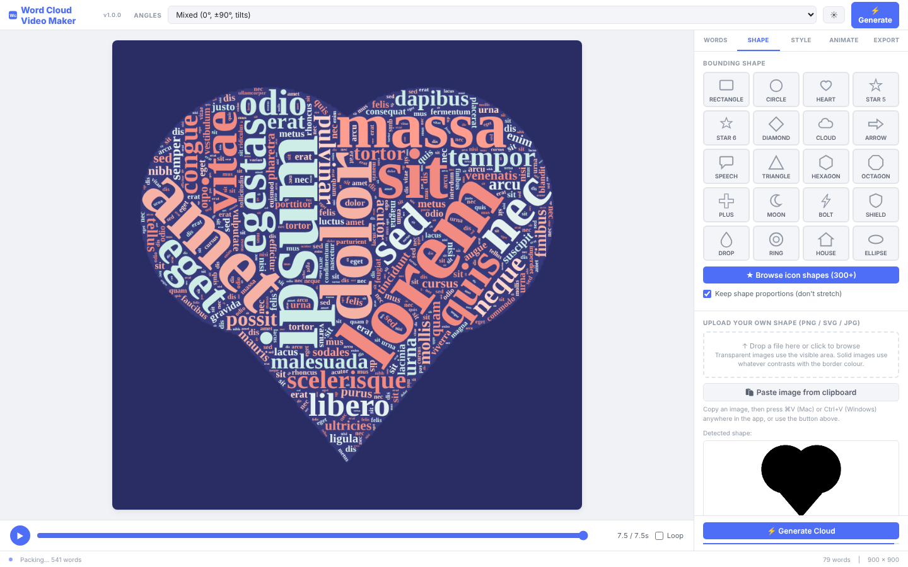
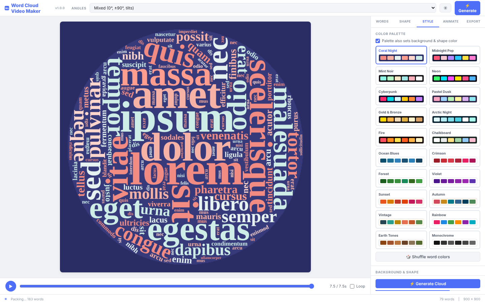
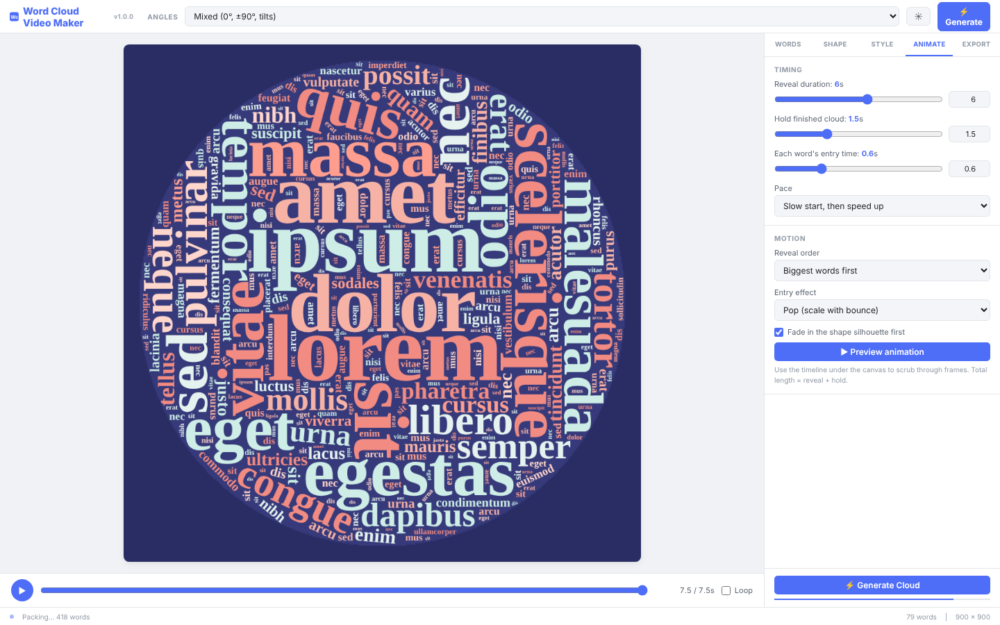
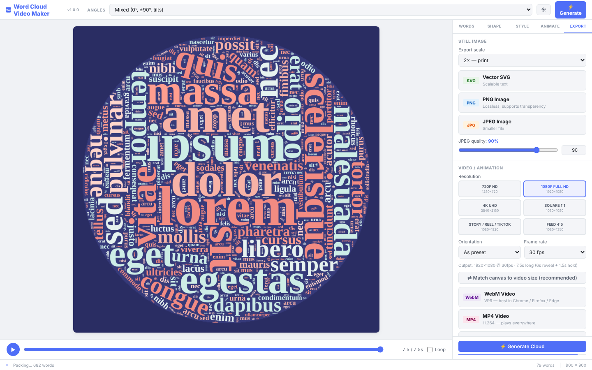
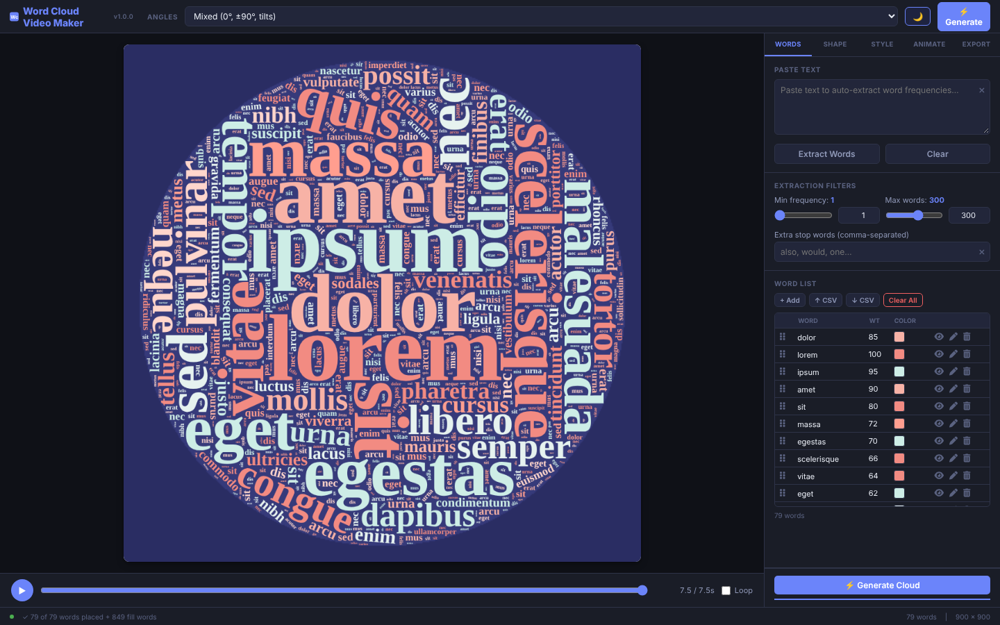

# Word Cloud Video Maker: User Manual

**Version 1.0.0**

This guide explains every part of the app in plain language. You do not need any technical background to use it. Where a technical word or abbreviation first appears, it is explained in the Glossary at the end.

---

## Contents

1. [What is a word cloud?](#1-what-is-a-word-cloud)
2. [Opening the app](#2-opening-the-app)
3. [Tour of the screen](#3-tour-of-the-screen)
4. [Step 1: The Words tab](#4-step-1-the-words-tab)
5. [Step 2: The Shape tab](#5-step-2-the-shape-tab)
6. [Step 3: The Style tab](#6-step-3-the-style-tab)
7. [Step 4: The Animate tab](#7-step-4-the-animate-tab)
8. [Step 5: The Export tab](#8-step-5-the-export-tab)
9. [Light and dark mode](#9-light-and-dark-mode)
10. [Browser notes (Mac, iPhone, iPad)](#10-browser-notes-mac-iphone-ipad)
11. [Troubleshooting](#11-troubleshooting)
12. [Glossary](#12-glossary)

---

## 1. What is a word cloud?

A word cloud is a picture made of words. The more important a word is, the bigger it appears. In this app, you give the program a list of words and how important each one is. The program then fits the words, one after another, into a shape until the shape is filled.

Common uses include summarising a speech, showing the most common topics in customer feedback, decorating a presentation, or making a short animated title card for a video.

---

## 2. Opening the app

1. Find the file called **word-cloud-video-maker.html** in the project folder.
2. Double-click it. It opens in your web browser.
3. The app starts with some sample words already loaded, so you can see what it does straight away.

You do not need to install anything, and nothing you make leaves your computer unless you choose to share the downloaded file.

---

## 3. Tour of the screen

The screen has three main areas.

**The top bar** runs across the top. From left to right it shows:

- The app name, with the **version number** (for example "v1.0.0") in small grey type beside it. This tells you which release of the app you are using.
- **ANGLES**: a quick menu for the direction the words run. It is the same setting as on the Shape tab.
- A **sun/moon button** that switches between light and dark mode.
- A blue **Generate** button that rebuilds the word cloud with your current settings.

**The preview** fills the middle-left of the screen. This is what your word cloud will look like. Under the preview is the **timeline bar**. It has a play button, a bar you can drag, a time readout such as "7.5 / 7.5s", and a **Loop** tick box that makes the animation repeat.

**The control panel** runs down the right side. It has five tabs across the top:

- **Words**: the word list and text you paste in.
- **Shape**: the outline the words fill.
- **Style**: colours, background, and fonts.
- **Animate**: how the words appear over time.
- **Export**: saving your work as a picture or a video.

Click a tab name to switch to it. The most-used controls are placed near the top of each tab, so you rarely need to scroll.

At the very bottom, a **status bar** tells you what the app is doing, for example "Packing… 40 words" while it is working, or "79 words placed" when it has finished. A thin blue line under the Generate button shows progress.

---

## 4. Step 1: The Words tab

### 4.1 Pasting text

1. Copy any text, such as an article, a speech, or a list of comments.
2. Click in the large **Paste Text** box and paste it (Command+V on a Mac, Ctrl+V on Windows).
3. Click **Extract Words**.

The app counts how often each word appears, skips very common small words such as "the", "and", and "of", and creates a list. The most frequent word becomes the largest word.

Click **Clear** to empty the box.

### 4.2 Extraction filters

These settings control which words are kept when you extract them from text.

- **Min frequency**: a word must appear at least this many times. Set it higher to remove rare words.
- **Max words**: the most words to keep. The default is 300.
- **Extra stop words**: type words you would like the app to ignore, separated by commas, for example *also, would, one*. These are added to the built-in list of ignored words.

### 4.3 Number boxes next to sliders

Every slider in the app, which is the bar you drag left and right, has a small **number box** beside it. Type an exact value in the box and press **Enter** (or click outside the box) to set it precisely. The slider moves to match. This is useful when you need a specific size or time.

### 4.4 The word list

The word list shows every word in the cloud, one per row. Each row has these parts:

| Column | What it shows |
|---|---|
| The grip icon (six small dots, ⋮⋮) | Drag this to move the word up or down the list |
| Word | The word itself |
| Wt | The weight, from 1 to 100. Bigger means a larger word |
| Colour | A small colour square. Click it while the row is being edited to change the colour |
| Eye icon | Hide or show the word on the cloud |
| Pencil icon | Edit the word. The pencil becomes a tick when you are editing |
| Bin icon | Delete the word from the list |

**Rearranging words (drag and drop).** Press and hold the grip icon, move your pointer or finger up or down, and let go. This works with a mouse, a trackpad, or a touch screen. The order of the list matters: words near the top are placed into the cloud first, so they get first choice of space. The sorting is applied as soon as you release the grip.

**Hiding a word.** Click the eye icon. The word stays in the list but is dimmed and crossed out, and it disappears from the cloud. While a word is hidden, its icon shows a crossed-out eye. Click the icon again to show the word. Hiding is useful when you want to test a cloud without a word, without losing its colour and weight.

**Editing a word.** Click the pencil icon. The row changes so you can type a new word, change its weight, or pick a colour. When you are finished, click the tick icon to confirm. The cloud updates to match. Only one row can be in edit mode at a time.

**Deleting a word.** Click the bin icon. The word is removed straight away, so make sure you mean it. You can always add it back with **+ Add**, or re-paste your text.

### 4.5 Other word-list buttons

- **+ Add**: adds a new row called "newword" at the top of the list, already in edit mode, so you can type over it.
- **↑ CSV**: loads a list from a spreadsheet file saved as CSV. CSV stands for "comma-separated values", a simple format that spreadsheets can save. Each line should contain a word, then a comma, then a weight (1 to 100), and optionally a comma and a colour code such as `#ff0000`.
- **↓ CSV**: saves your current word list to a CSV file, so you can keep it or reuse it later.
- **Clear All**: removes every word. The app asks you to confirm first.

The small count at the bottom of the list, such as "79 words", tells you how many words are in the list, including hidden ones.

### 4.6 Clear (×) buttons in text boxes

Every text box in the app has a small grey **×** at its right-hand edge. Click it to empty that box straight away.

---

## 5. Step 2: The Shape tab

### 5.1 Choosing a built-in shape

The grid shows 20 shapes, including rectangle, circle, heart, star, cloud, arrow, speech bubble, and house. Click one to use it. The shape is the outline the words will fill.

**Browse icon shapes (300+).** Click this blue button to open a larger window with more than 300 icons, such as an animal, a tree, a car, or a light bulb. Use the search box at the top, or click a category such as Animals or Travel. Click an icon to use it as the shape. Click **No shape** to fill the whole canvas instead.

**Keep shape proportions.** When this box is ticked, shapes keep their natural proportions and are not stretched to fit a rectangular canvas. Untick it if you want the shape to fill the canvas exactly, even if that distorts it.

### 5.2 Uploading your own shape

You can use any picture as the outline, as long as it is a PNG, SVG, JPEG, or WebP file.

- **PNG** files can have a transparent background. Where the picture is transparent, the words are placed; where it is solid, the words avoid it. Transparent PNG files give the cleanest results.
- **SVG** files are drawings made of lines and shapes that stay sharp at any size.
- **JPEG** and **WebP** files have solid backgrounds. The app looks for the part of the picture that contrasts with the edge and treats that as the shape.

To upload a shape, do one of these:

1. **Drag** the file from your computer and drop it onto the dashed box.
2. **Click** the dashed box to open a file picker and choose the file.
3. **Copy** an image, then click **Paste image from clipboard**, or press Command+V (Mac) or Ctrl+V (Windows) anywhere in the app.

The app shows a black-and-white preview called **Detected shape** under the box. Check it. If the shape looks inverted (the outside is filled instead of the inside), tick **Invert (fill the outside instead)**.

**Automatic trimming.** When you upload a transparent picture, the app crops it to the shape and leaves a margin of about **25 pixels** all the way round. This removes wasted empty space so the shape fills the canvas better. The margin keeps the outline from touching the edge.

Click **Remove Uploaded Shape** to go back to a built-in shape.

### 5.3 Packing (how the words fit)

- **Word angles**: how words are turned. *Mixed* turns most words flat, some upright, and some tilted. *Horizontal* keeps everything flat for a clean, readable look. *Any angle* allows free rotation for a more playful effect. The same setting appears at the top of the screen.
- **Spiral**: the path the program follows when looking for a space for each word. *Archimedean* is round and natural. *Rectangular* is boxy and suits square designs.
- **Word gap**: the space left between words, in pixels. A pixel is one dot on the screen.
- **Packing effort**: how hard the program tries to fit each word. Higher values pack words more tightly but take longer.
- **Fill gaps by repeating words at smaller sizes**: after the main words are placed, the app fills any remaining holes with smaller copies of the words. Turn this off for a cleaner, sparser look.
- **Smallest fill word**: the smallest size, in pixels, used for those filler words.

While the app is working, the status bar shows progress. A large word list with high packing effort can take a few seconds.

### 5.4 Canvas format

The canvas is the rectangle the cloud is drawn on. Click a format to set its size:

- **Square** (900 × 900), **16:9** and **16:9 HD** for widescreen video, **4:3**, **Instagram** (square), **Story 9:16** (tall, for phone stories), **Facebook**, **Twitter/X**, **YouTube**, and **A4 Landscape** (for printing).

The numbers under each name are the width and height in pixels. You can also type your own **Width** and **Height**.

---

## 6. Step 3: The Style tab

### 6.1 Colour palette

Click a palette card to apply it. Each card shows the background and the colours it uses. There are 20 palettes, from *Coral Night* and *Neon* to *Ocean Blues*, *Forest*, and *Vintage*.

- **Palette also sets background & shape colour**: when ticked, choosing a palette also changes the background and shape colours. Untick it to keep your own background.
- **Shuffle word colours**: randomly reassigns colours to the words within the current palette.

The app automatically avoids word colours that are too close to the background, so words stay readable.

### 6.2 Background and shape

- **Background**: pick a colour with the colour square, or type a code such as `#2a2d63`.
- **Transparent**: makes the background see-through. Useful when you want to place the cloud on a photo or another design. Transparent backgrounds are kept in PNG and SVG files, but not in JPEG files, which always have a background.
- **Show shape silhouette behind words**: draws the shape in a slightly different colour behind the words, so the outline is visible.
- **Silhouette colour**: the colour of that background shape.

### 6.3 Font

- **Family**: the typeface. *Mixed fonts* picks a different familiar font for each word. Choosing a single font makes the whole cloud consistent.
- **Weight**: how thick the letters are. *Bold* is the default; *Black* is thicker still.
- **Min size** and **Max size**: the smallest and largest word size. Sizes are based on a 600-pixel canvas and grow or shrink with the canvas you choose.

Fonts are the ones already installed on your computer or device. Because of this, the same font may look slightly different on a Mac, a Windows PC, and an iPhone.

---

## 7. Step 4: The Animate tab

These settings control how the cloud appears over time. Use the timeline bar under the preview to watch it.

### 7.1 Timing

- **Reveal duration**: how many seconds it takes for all the words to appear. The default is 6 seconds.
- **Hold finished cloud**: how many seconds the completed cloud stays on screen at the end. The default is 1.5 seconds.
- **Each word's entry time**: how long each individual word takes to appear, in seconds.
- **Pace**: whether words appear at an even rate, start slowly and speed up, or start quickly and slow down.

The total length, shown in the timeline, is the reveal duration plus the hold time.

### 7.2 Motion

- **Reveal order**: which words appear first. Choices include *Biggest words first*, *Random*, *Center outward*, *Edges inward*, *Top to bottom*, *Bottom to top*, *Left to right*, and *Clockwise sweep*.
- **Entry effect**: how each word arrives. *Pop* grows with a slight bounce. *Fade in* becomes gradually visible. *Zoom down* shrinks from large. *Fly in* comes in from outside the canvas. *Drop* falls from above. *Spin in* turns as it appears. *Instant* simply appears.
- **Fade in the shape silhouette first**: the outline fades in before the words start.

Click **▶ Preview animation** to play the reveal from the beginning.

---

## 8. Step 5: The Export tab

Before you export, make sure the cloud looks right. Exporting uses the current word list, shape, colours, and animation settings.

### 8.1 Still images

- **Export scale**: how large the picture is. *1×* is screen size, *2×* is good for printing, and *4×* is very large. A larger scale gives a bigger file.

Then click one of the three buttons:

- **SVG (Vector)**: a drawing file in which the words stay sharp at any size. Best for designers and for printing at large sizes. Most programs that edit drawings can open it.
- **PNG (Image)**: a high-quality picture that keeps transparent backgrounds. Good for websites and presentations.
- **JPEG (Image)**: a smaller picture file without transparency. Use the **JPEG quality** slider to trade quality for file size. Higher numbers look better but make larger files.

### 8.2 Video and animation

- **Resolution**: choose a size for the video, such as *720p HD*, *1080p Full HD*, *4K UHD*, *Square 1:1*, *Story / Reel / TikTok* (tall), or *Feed 4:5*.
- **Orientation**: *As preset* uses the shape of the resolution you chose. The other options turn the video landscape, portrait, or square.
- **Frame rate**: how many pictures are shown each second. 30 frames per second is smooth and suitable for most uses. 60 is smoother but makes larger files.
- **Match canvas to video size (recommended)**: sets the preview canvas to the same proportions as the video, so what you see is what you get.

Then choose a format:

- **WebM Video**: a web-friendly video format. Best in Chrome, Edge, and Firefox. Not supported by Safari.
- **MP4 Video**: the most widely used video format. Works in almost every app and device, and is the one to choose on a Mac or iPhone.
- **Animated GIF**: a short looping animation that plays almost anywhere, including inside email and chat. Use the **GIF size** menu to choose its largest dimension. Larger sizes look better but create bigger files.

**Important:** WebM and MP4 videos are recorded in real time. This means the video takes as long to make as it is long (for example, a 7.5-second cloud takes about 7.5 seconds to record). Keep the browser tab open and visible while recording, and do not switch to another tab. GIF files are built frame by frame and do not need you to watch, but they can take a little while to finish.

While a video is recording or a GIF is being built, the status bar shows progress as a percentage. The Generate buttons are switched off during this time so the cloud cannot change mid-recording.

### 8.3 File names

Every downloaded file follows the same pattern:

**YYYY-MM-DD WordCloudVideoMaker-[Shape]-[Width]x[Height].[format]**

For example: `2026-10-24 WordCloudVideoMaker-Heart-1080x1080.mp4`

- **YYYY-MM-DD** is today's date: year, month, day.
- **[Shape]** is the name of the shape you used. For a custom picture, it says *Custom*. For a chosen icon, it uses the icon's name.
- **[Width]x[Height]** is the size of the file in pixels.
- **[format]** is the file type, such as png, jpg, svg, webm, mp4, or gif.

Downloaded files go to your browser's usual download folder, usually **Downloads**.

---

## 9. Light and dark mode

Click the **sun/moon button** in the top bar to switch between the two modes.

- **Light mode** uses a white background with dark text. It is best for daytime and for printing previews.
- **Dark mode** uses a dark background with light text. It is easier on the eyes in a dim room.

The app remembers your choice the next time you open it. The first time, it matches your computer's own setting.

Dark mode only changes how the app's controls look. It does not change the word cloud itself, which uses the palette and background you chose.

---

## 10. Browser notes (Mac, iPhone, iPad)

The app is designed to work in the following browsers:

- **Chrome, Edge, and Firefox** on Windows, Mac, Linux, and Chromebook. These handle every feature, including WebM video.
- **Safari** on Mac, iPhone, and iPad. Safari supports most features, including MP4 video and animated GIFs. It does **not** support WebM video. Use the MP4 option instead.

**Touch screens (iPad and iPhone).** On a touch screen, the sliders are made larger so they are easier to drag with a finger. The grip icon for reordering words also works with touch.

**Pasting images in Safari.** When you click **Paste image from clipboard** in Safari, Safari may ask for permission to read your clipboard. Choose Allow. If Safari does not allow it, use Command+V instead: click somewhere in the app first, then press Command+V.

**Keyboard shortcut for playing the animation.** Press the space bar (when you are not typing in a box) to play or pause the timeline.

**Recording video on an iPhone or iPad.** Recording is real time, so keep the screen on and the Safari tab open. Turn off Low Power Mode and keep the device plugged in if the recording is long.

**Note:** The app was built to work in Safari, but it was tested in a Chromium-based browser. Please let the author know if anything behaves differently in Safari.

---

## 11. Troubleshooting

**The icon shapes are missing, or the icon buttons show as blank squares.**
The icons are read from the `assets/fontawesome` folder. Make sure the project folder is unzipped in full, and that the HTML file stays in the same folder as the `assets` folder.

**The word cloud looks empty, or says "Shape is empty".**
The chosen shape has no area inside it. This can happen with an uploaded picture that has no clear shape. Try ticking **Invert**, or upload a picture with a clearer outline.

**Words are missing from the cloud.**
Check whether the word is hidden (its eye icon is crossed out), whether it is too long for the chosen canvas, or whether the canvas is too small. Try a larger canvas, reduce the maximum word size on the Style tab, or lower the packing effort.

**The status says "Packing…" for a long time.**
Large word lists, high packing effort, and large canvases all take longer. Wait for the status bar to show "placed". Lower the packing effort for a faster result.

**Paste does nothing.**
Make sure you copied an image, not a file name or some text. Click inside the app before pressing Command+V or Ctrl+V.

**The video recording came out empty.**
Keep the browser tab in front and visible during recording. Choose MP4 if you are using Safari.

**The app doesn't look right on my phone.**
The app is designed for a computer screen. On a phone, use landscape orientation and scroll the control panel. For the best experience, use a tablet or computer.

---

## 12. Glossary

- **App**: a program that runs in a web browser, such as this one.
- **Browser**: the program you use to visit websites, such as Safari, Chrome, Edge, or Firefox.
- **Canvas**: the rectangle on which the word cloud is drawn.
- **CSV (comma-separated values)**: a simple file format for lists and tables, which spreadsheets can open and save.
- **Downloads folder**: the place on your computer where your browser saves files you download.
- **Favicon**: the small icon shown in a browser tab, beside the page title.
- **Frame rate (fps)**: frames per second. The number of still pictures shown each second in a video.
- **GIF (Graphics Interchange Format)**: a format for short animations that loop.
- **Icon library**: a collection of ready-made picture symbols. This app uses Font Awesome.
- **JPEG (or JPG)**: a picture format that makes small files. It does not support transparent backgrounds.
- **MIT Licence**: a permissive licence that lets people use and change the software, as long as the original copyright notice is kept.
- **MP4 (MPEG-4)**: a widely used video format that plays on almost every device.
- **PNG (Portable Network Graphics)**: a high-quality picture format that supports transparent backgrounds.
- **Pixel**: one dot on a screen or in a digital picture. A 1080-pixel-wide video is 1080 dots across.
- **SVG (Scalable Vector Graphics)**: a drawing format that stays sharp at any size.
- **Transparent background**: a background that lets whatever is behind it show through.
- **Version number**: the release number of the app, for example 1.0.0. The first number is the major release, the second is a feature update, and the third is a small fix.
- **WebM**: a video format designed for the web. Best supported by Chrome, Edge, and Firefox.
- **Weight**: how important a word is, from 1 to 100. Higher weights make bigger words.

---

*Word Cloud Video Maker is released under the MIT Licence. Icons are from Font Awesome. See THIRD-PARTY-LICENSES.md for details.*
