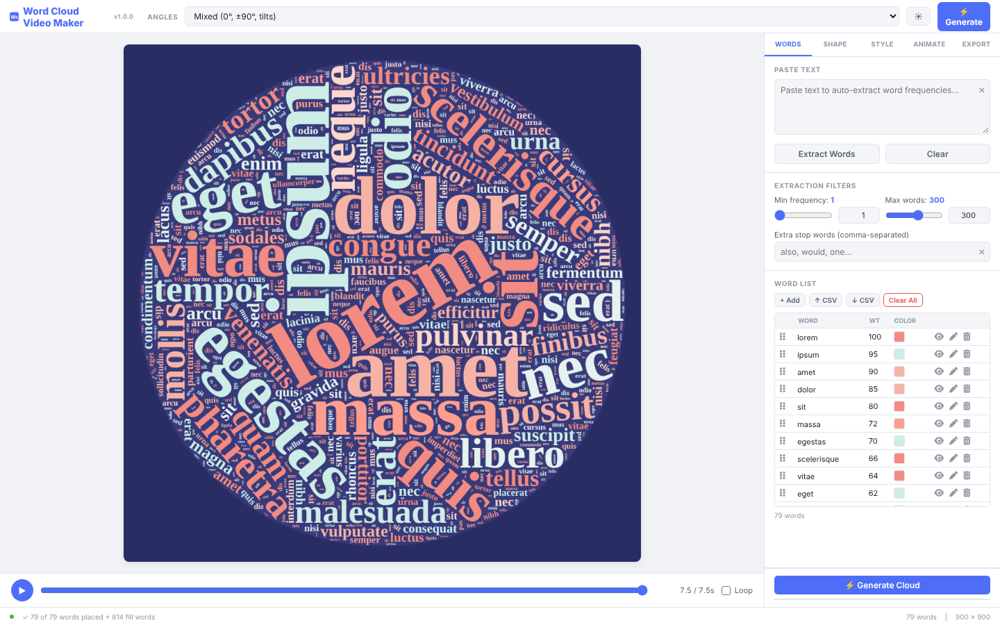
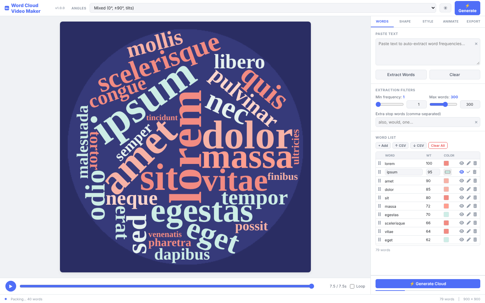

# Word Cloud Video Maker
[Launch Word Cloud Video Maker app](https://dougalder.github.io/word-cloud-video-maker/word-cloud-video-maker.html/)
**Version 1.0.0**

Word Cloud Video Maker turns a list of words into a picture or a short animation. Each word is sized by how important it is. You can paste in any text and the app will count the words for you, or you can type your own list. The words are packed into a shape you choose, such as a heart, a circle, or a shape you upload. You can then download the result as a still image or as a video.

The app runs entirely in your web browser. Nothing is uploaded to a server, and no account is needed.

## Features at a glance

- **Paste text and extract words.** The app counts word frequency and skips common small words such as "the" and "and".
- **Full word list.** Drag rows to reorder them, hide a word without deleting it, edit a word, or delete it.
- **Shapes.** Choose from 20 built-in shapes, pick from more than 300 icon shapes, or upload your own picture.
- **Paste a picture.** Copy an image, then press Command+V (Mac) or Ctrl+V (Windows), or use the paste button.
- **Colour palettes.** Twenty ready-made colour schemes, with light and dark backgrounds.
- **Animation.** Control how the words appear, in what order, and how long the reveal takes.
- **Export.** Save still images (SVG, PNG, JPEG), videos (WebM, MP4), or animated GIFs.
- **Light and dark mode.** Use the sun/moon button at the top of the screen.

## Screenshots

| | |
|---|---|
|  |  |
| Main screen, light mode | Word list, with one word in edit mode |

See the full user guide in [MANUAL.md](MANUAL.md).

## How to run it

1. Download this project (see "Getting the files" below).
2. Unzip the folder if it arrived as a zip file.
3. Double-click **word-cloud-video-maker.html**. It opens in your default web browser.

Keep the folder structure as it is. The icon shapes read their icons from the `assets/fontawesome` folder, so moving the HTML file on its own will hide them. Everything else is contained in the single HTML file.

**Browsers that work:** Safari on Mac and iPhone/iPad (version 15 or later recommended), Chrome, Edge, and Firefox. For the best video results, use Chrome or Edge on a computer. See the "Browser notes" section of the manual for details.

## Getting the files

- **Easiest:** Download the zip file from the project page and unzip it.
- **Using GitHub:** GitHub is a website where people store and share project files. Create a new repository, choose "Upload files," and drag the unzipped contents into the window. Then press "Commit changes."
- **Viewing online with GitHub Pages:** Once the files are on GitHub, you can turn on "GitHub Pages" in the repository's Settings to run the app from a web address. The index.html page is the front door for that.

## Project contents

```
word-cloud-video-maker/
├── word-cloud-video-maker.html   The app itself (open this file)
├── index.html                    A landing page that links to the app
├── README.md                     This file
├── MANUAL.md                     The full user guide
├── LICENSE                       The MIT licence (your rights to use the code)
├── THIRD-PARTY-LICENSES.md       Licences for material the app uses from others
└── assets/
    ├── favicon/                  The small icon shown in browser tabs
    ├── fontawesome/              Icon library used for the icon shapes and buttons
    └── screenshots/              Pictures used in this README and the manual
```

## Licence

This project is released under the **MIT Licence**. In plain terms, you may use, copy, change, and share the code, including for commercial work, as long as the copyright notice and licence text are kept with it. The full text is in the LICENSE file.

Copyright (c) 2026 Douglas Alder.

Material from other people is listed separately in [THIRD-PARTY-LICENSES.md](THIRD-PARTY-LICENSES.md). The main item is the Font Awesome icon library, which requires credit.

## Credits

- **Created by:** Douglas Alder
- **Icons:** Font Awesome Free 6.5.1 by Fonticons, Inc. (https://fontawesome.com)
- **Demonstration text:** Lorem Ipsum placeholder text, which is in the public domain.

## Feedback

If something does not work, note the version number (shown in small type beside the app name at the top of the screen), the browser and device you used, and what you were doing when the problem appeared.
